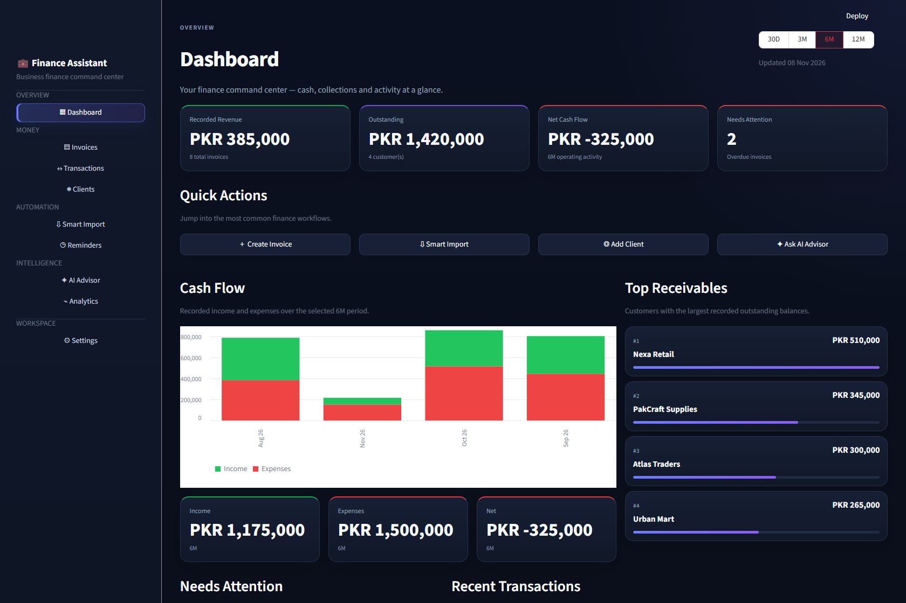
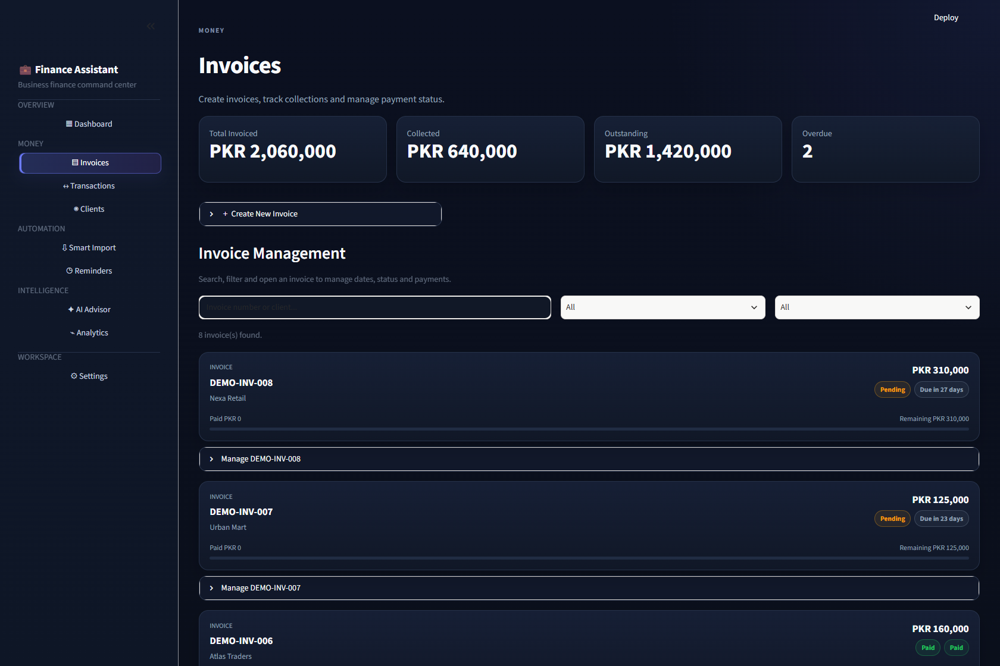
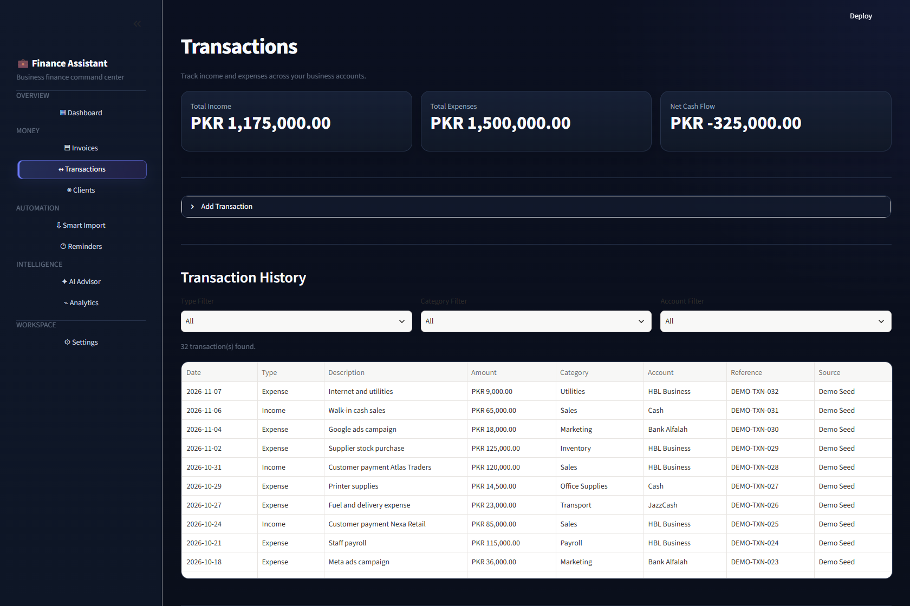
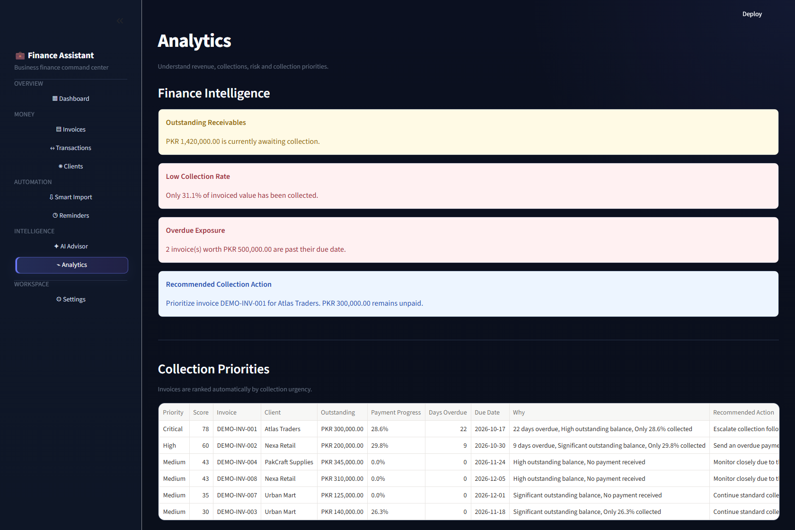
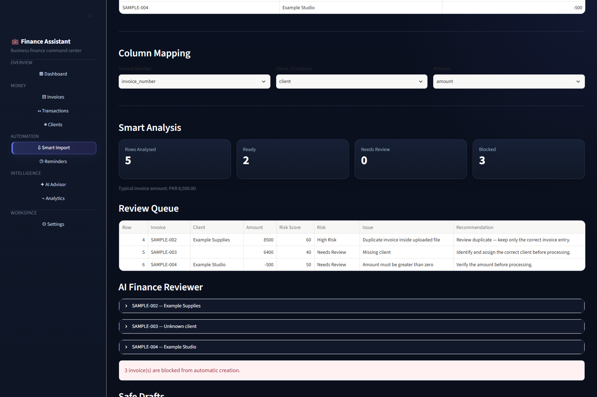

# Finance Assistant

A Python and Streamlit portfolio project for organising client records, invoices,
payments and business transactions in one workspace.

The application combines a PostgreSQL data layer with spreadsheet imports,
invoice review rules, PDF invoice generation and collection analytics. It is a
development prototype, not a production accounting system.

## Demo screenshots

Captured from the running app on 8 November 2026 using a disposable PostgreSQL
database and synthetic records. Amounts are in PKR.



<details>
<summary>View invoices, transactions, analytics and import validation</summary>

### Invoice management



### Transaction history



### Collection analytics



### Spreadsheet validation

The sample CSV produces two ready rows and three blocked rows: a duplicate
invoice, a missing client and a negative amount.



</details>

The local demo walkthrough, payment calculations, PDF generation and data exports
were checked. See [verification notes](docs/VERIFICATION.md) for scope and limits.

## What is implemented

| Area | Capabilities in the current interface |
| --- | --- |
| Dashboard | Invoice, payment and transaction summaries |
| Clients | Create and maintain customer contact records |
| Invoices | Track invoice dates, status and payments; generate PDF invoices |
| Transactions | Record income and expenses, suggest categories and retain category corrections |
| Smart Import | Import CSV/XLSX/XLS files, map columns, flag problematic invoice rows and record review decisions |
| Analytics | Rule-based invoice insights and collection priorities |
| Reminders | Review collection reminders; Gmail sending requires separate OAuth setup |
| Settings | Business settings, categories and data exports |

### What “AI” means in this version

The functions in `ai/finance_ai.py` currently use deterministic rules and
calculations. They do **not** call an LLM or require an OpenAI API key.
The AI Advisor navigation item is a placeholder in `app.py`. Additional advisor,
forecast, report and transaction-import modules exist in the repository but are
not currently wired into the main navigation. These are not presented as finished
features of the running interface.

## Technology

- **Python / Streamlit:** application and interactive interface
- **Pandas:** tabular data processing
- **PostgreSQL / Psycopg:** persistent storage and connection pooling
- **ReportLab:** PDF invoice generation
- **Google API client / MSAL:** email integration helpers
- **Openpyxl / xlrd:** Excel import engines

The current database implementation uses **PostgreSQL, not SQLite**.

## Run locally

Use Python 3.12 and a dedicated PostgreSQL database. Run commands from the
repository root.

```powershell
git clone https://github.com/rimshahmmalik-commits/finance-assistant.git
cd finance-assistant
python -m venv .venv
.venv\Scripts\python -m pip install -r requirements.txt
Copy-Item .env.example .env
```

Edit `.env` and replace `DATABASE_URL` with your development connection string.
The database must already exist; the app creates its tables on startup. Use a
database account allowed to create tables and read/write the application data.
URL-encode special characters in a connection-string password.

```powershell
.venv\Scripts\python -m streamlit run app.py
```

Open the local URL printed by Streamlit, normally `http://localhost:8501`.
For macOS/Linux, use `.venv/bin/python` and `cp .env.example .env` instead.

### Optional local database with Docker

If Docker Compose is installed, the included development configuration starts a
PostgreSQL database bound to localhost:

```powershell
docker compose up -d db
```

The example `.env` connection string matches this disposable local database.
These credentials are for local development only. Stop it with
`docker compose stop db`; its named volume retains data.

## Try the demo

After configuring a **dedicated disposable database**, run:

```powershell
.venv\Scripts\python seed_demo.py
.venv\Scripts\python -m streamlit run app.py
```

The seeder creates 5 sample clients, 8 invoices, 5 payment events and 32
transactions. Dates are relative to the day it runs. It replaces demo-prefixed
records and records matching its sample company names, so do not run it against
an existing business database. Contact addresses use the reserved `example.com`
domain. Do not configure email credentials when exploring the demo.

Suggested walkthrough:

1. Open **Dashboard** to see the seeded invoice and transaction summaries.
2. Open **Invoices** to inspect paid, unpaid and partially paid examples.
3. Open **Transactions** to inspect categorisation and cash activity.
4. Upload `examples/invoice_import.csv` through **Smart Import** and map
   `invoice_number`, `client` and `amount`. It deliberately includes a duplicate,
   a missing client and a negative amount to demonstrate review flags.
5. Review **Analytics** and the reminder queue without sending email.

## Email integrations

Email is optional for browsing the finance interface. The current Reminder Center
and background reminder automation call the **Gmail** sender. Sending needs a
Google OAuth desktop-client configuration saved locally as
`gmail_credentials.json`; the first authorisation creates `gmail_token.json`.
Neither file belongs in Git. Use only your own test inbox when validating email.

Microsoft Graph sending helpers also exist in `email_service/sender.py` and use
`MICROSOFT_CLIENT_ID` and `MICROSOFT_TENANT_ID`. They are not currently the sender
used by the reminder interface. The optional scheduler is separate from the web
app (`python -m email_service.scheduler`) and can send real messages; do not run
it for a portfolio demonstration.

## Repository guide

```text
app.py                  Streamlit entry point and navigation
database/database.py    PostgreSQL schema, queries and business data operations
views/                  Interface pages and additional development modules
ai/finance_ai.py        Rule-based review, insights and forecasting logic
email_service/          Gmail/Graph helpers and reminder automation
utils/                  Shared helpers and interface theme
seed_demo.py            Repeatable sample-data setup
examples/               Synthetic invoice-import example
```

## Current limits and next steps

- No application login, tenant isolation or role-based access is implemented.
  Keep the app local and use synthetic data for demonstrations.
- Monetary amounts currently use floating-point storage; decimal-safe handling,
  stronger constraints and formal migrations are future improvements.
- The reminder scheduler needs its own running process; OAuth and sending require
  integration testing in the target environment.
- No bank connection, payment gateway, OCR/PDF invoice extraction or production
  LLM integration is claimed.
- Local database and interface checks passed with synthetic data. Production
  deployment and email integrations still need testing in their target environment.
  See [verification notes](docs/VERIFICATION.md).

## Portfolio summary

> Finance and invoice operations prototype built with Python, Streamlit, Pandas
> and PostgreSQL. Includes spreadsheet invoice validation, payment tracking,
> PDF invoices and rule-based collection insights.

This repository demonstrates application structure, relational data operations,
data validation and translating business workflows into an interactive tool.
No commercial adoption, time savings or production accuracy figures are claimed.
